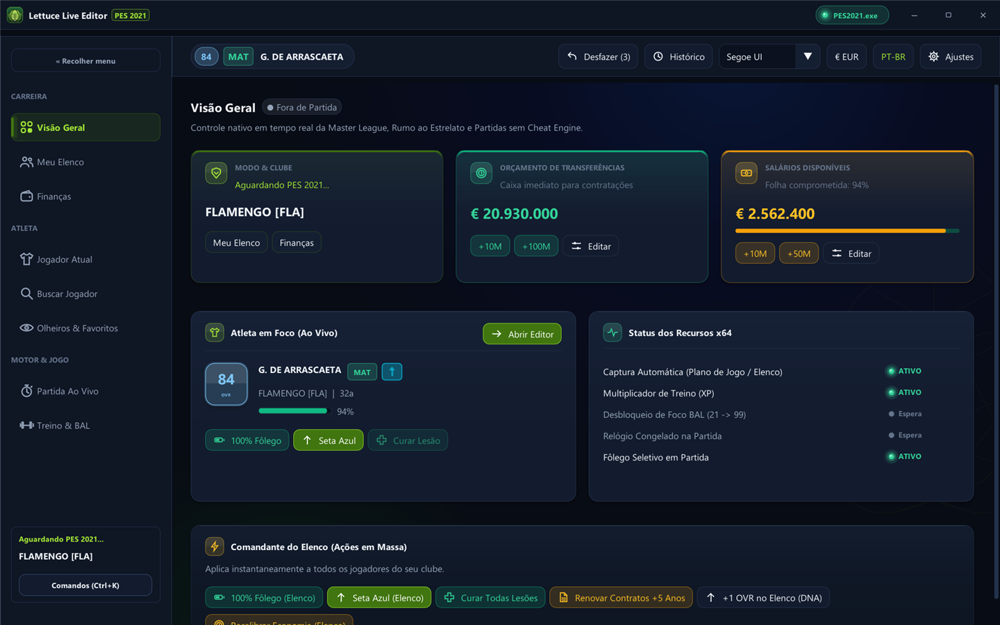
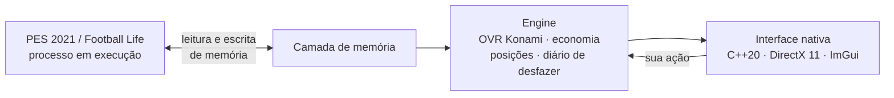
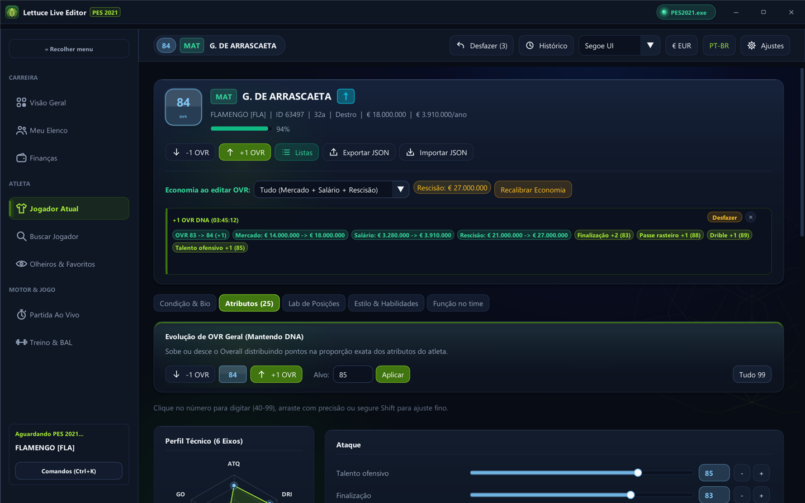
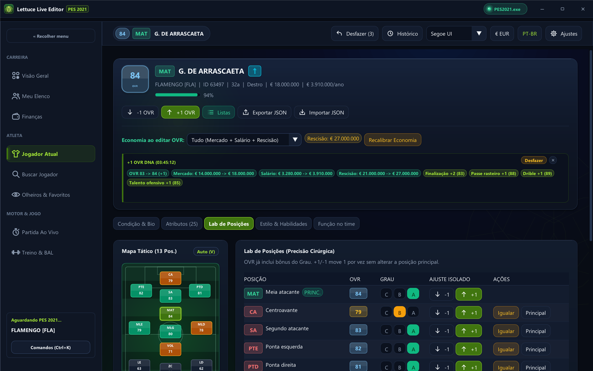
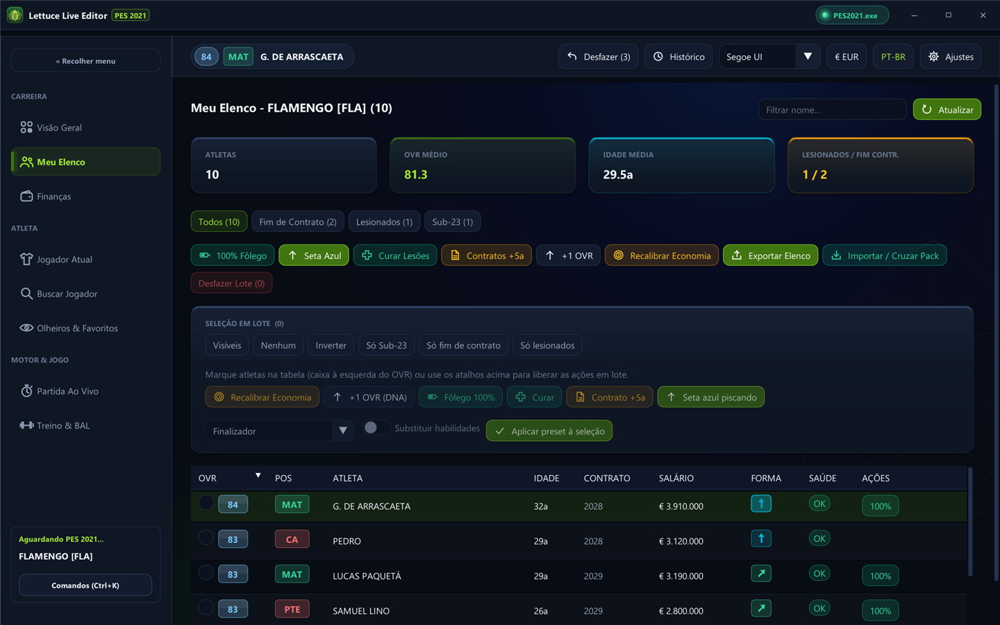
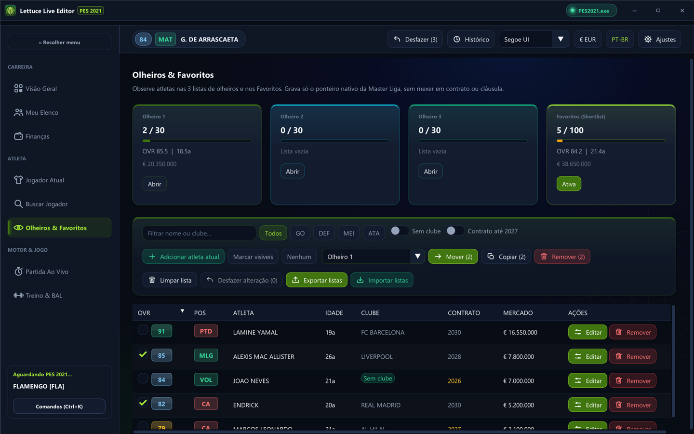
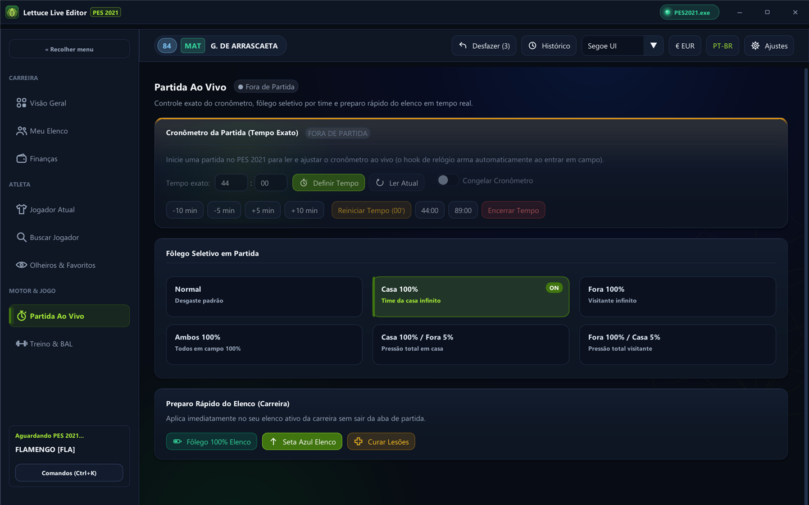
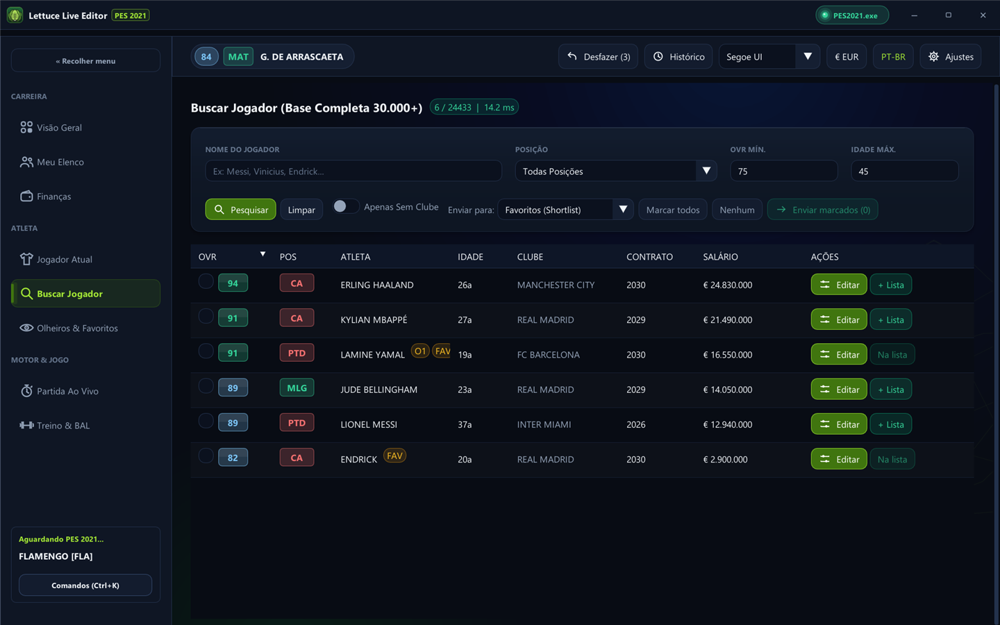
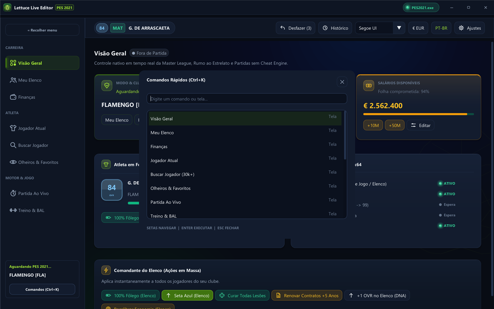
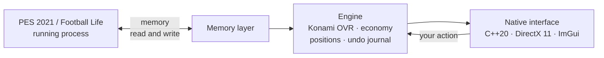

<div align="center">


# PES 2021 - Lettuce Live Editor

### O modo carreira, sem portas trancadas.
### Career mode, with the doors unlocked.


-0095D9?style=for-the-badge)


<br>



<sub>Capturas com dados de exemplo. Screenshots use sample data.</sub>

<br>

**[Português](#português)** · **[English](#english)** · **[Build / Testes / Tests](#build--testes--tests)**

</div>

---

## Português

### A ideia

Um save de Master Liga é, no fundo, **um estado vivo na memória do jogo**. A maioria dos editores trata esse estado como uma planilha: você muda um número e torce para o resto continuar fazendo sentido. Só que não faz. Um OVR alterado sem mexer nos atributos vira uma mentira que o jogo corrige sozinho na próxima partida. Um valor de mercado digitado à mão quebra a economia do clube. E um erro sem volta custa um save inteiro.

O Lettuce Live Editor parte da pergunta contrária: **o que o jogo precisaria aceitar para que a sua edição parecesse natural?** A resposta virou cinco princípios, e quase tudo no app nasce de um deles.

<table>
<tr>
<td width="20%" valign="top"><b>1. Coerência</b></td>
<td>Editar um número nunca deixa o resto do atleta inconsistente. O OVR é recalculado pela fórmula da Konami, os atributos mudam na proporção do perfil do jogador (o <i>DNA</i>), e mercado, salário e multa acompanham idade, posição e país.</td>
</tr>
<tr>
<td valign="top"><b>2. Reversibilidade</b></td>
<td>Toda alteração tem volta, em quatro escalas: por atleta (<code>Ctrl+Z</code>), em lote, nas listas de olheiros e por uma linha do tempo global. Antes de lotes que mexem em valores, o app grava um backup JSON do elenco.</td>
</tr>
<tr>
<td valign="top"><b>3. Transparência</b></td>
<td>Nada acontece escondido. Cada ação mostra o que mudou, de quanto para quanto, e fica registrada no histórico com a hora.</td>
</tr>
<tr>
<td valign="top"><b>4. Respeito ao jogo</b></td>
<td>O limite nativo de 10 habilidades por atleta é mantido, a posição principal não se mexe quando você ajusta as secundárias e as listas de olheiros só gravam o ponteiro nativo, sem tocar em contrato ou cláusula.</td>
</tr>
<tr>
<td valign="top"><b>5. Leveza</b></td>
<td>Cerca de 2,6 MB, um único <code>.exe</code>, sem Cheat Engine e sem runtimes. O laço é guiado por eventos: com a janela parada, o consumo de CPU e GPU é praticamente zero.</td>
</tr>
</table>

### Em 30 segundos

1. Use o executável em `dist/PES 2021 Workbench Native.exe` (ou [compile](#build--testes--tests)).
2. Abra o **PES 2021** ou o **Football Life** e entre na **Master Liga** ou no **Rumo ao Estrelato**.
3. Abra o Lettuce Live Editor, como Administrador se o jogo estiver elevado.
4. Destaque um atleta no Plano de Jogo. O app o captura em segundo plano e abre tudo sobre ele.

### Como funciona



A interface nunca escreve direto no jogo. Toda ação passa pela engine, que valida, calcula as consequências (atributos, economia, posições), registra o estado anterior no diário e só então grava na memória. É por isso que desfazer funciona de verdade e que um lote de 40 atletas pode ser revertido de uma vez.

---

### Um tour pelo app

<table>
<tr>
<td width="50%" valign="top">

<h4>Atributos e solver de DNA</h4>
Peça <code>+1 OVR</code>, <code>-1 OVR</code> ou um <b>OVR alvo</b> entre 40 e 99. O solver redistribui os pontos na proporção do perfil do atleta e, depois, recalibra mercado, salário e multa. Resultado: um jogador mais forte que continua sendo <i>ele mesmo</i>.
</td>
<td width="50%" valign="top">

<h4>Lab de Posições</h4>
Um mapa tático com as 13 posições. Suba ou desça uma secundária de 1 em 1 sem encostar na principal, iguale à principal ou defina o grau <code>A / B / C</code>. O OVR mostrado já inclui o bônus do grau.
</td>
</tr>
<tr>
<td width="50%" valign="top">

<h4>Meu Elenco, em lote</h4>
Filtre por fim de contrato, lesão ou Sub-23, marque quem quiser e aplique de uma vez: recalibrar economia, <code>+1 OVR (DNA)</code>, fôlego, cura, contrato e seta. Dez <b>presets de habilidades</b> por função em campo (finalizador, ponta driblador, regista, zagueiro, goleiro e outros) sem estourar o limite de 10.
</td>
<td width="50%" valign="top">

<h4>Olheiros e Favoritos</h4>
As 4 listas nativas (3 de olheiros e a de favoritos) como cartões com OVR médio, idade média e valor. Filtre, mova, copie e remova em lote, desfaça até 12 passos e exporte ou importe tudo em JSON, cruzando por ID e por nome para levar a lista a outro save.
</td>
</tr>
<tr>
<td width="50%" valign="top">

<h4>Partida Ao Vivo</h4>
O app detecta a partida sozinho e mostra minuto e período. Defina o tempo exato, congele o cronômetro e escolha entre 6 modos de fôlego seletivo, de "Casa 100%" a "Fora 100% / Casa 5%".
</td>
<td width="50%" valign="top">

<h4>Busca em mais de 30 mil atletas</h4>
A base inteira do jogo, não só o seu elenco. Encontre qualquer jogador, abra o editor dele ou marque direto nas listas de olheiros.
</td>
</tr>
</table>

<div align="center">

<br><sub><b>Paleta de comandos</b> (<code>Ctrl+K</code>): qualquer ação a poucas teclas de distância.</sub>
</div>

---

### Por baixo do capô, em perguntas

| Pergunta | Resposta |
| --- | --- |
| **Como o OVR sobe sem "quebrar" o atleta?** | O app usa a fórmula exata da Konami como função de custo e um solver que preserva a proporção entre os atributos. 30.000 cálculos levam poucos milissegundos. |
| **E o dinheiro?** | Mercado, salário e multa vêm de um modelo econômico calibrado (curva 2025/26) que depende de OVR, idade, posição, país e versatilidade. É determinístico e reversível: voltar ao OVR antigo volta ao valor antigo. |
| **O que é a seta piscando?** | Uma flag independente das 5 setas de forma (bit 7 do byte `0x146` do registro do atleta). O app descreve o efeito com base no manual oficial da Konami e a anima nas tabelas. |
| **Posso errar à vontade?** | Pode. Cada atleta guarda 10 estados de desfazer, a linha do tempo global guarda até 300 ações, lotes têm "Desfazer Lote" e há backup JSON antes das operações pesadas. |
| **Funciona com patches?** | Sim. É compatível com o Sider 7.3+ e com derivados como Football Life, SmokePatch, VirtuaRED e Dream Patch. Se uma versão antiga do Workbench estiver aberta ao mesmo tempo, o app avisa do conflito. |
| **Compartilho edições entre saves?** | O **Pack Studio** (JSON v13) exporta atletas e elencos e importa em outro save, cruzando por ID, nome ou escolha manual, com prévia das diferenças e rollback do lote. |
| **E o treino?** | A tela **Treino & BAL** tem o multiplicador de Sub-XP do seu clube e o desbloqueio dos Pontos de Foco do Rumo ao Estrelato. |

### Atalhos que valem a pena

| Atalho | Ação |
| --- | --- |
| `Ctrl+K` | Paleta de comandos |
| `Ctrl+Z` | Desfazer a última edição do atleta |
| `Alt+Left` | Voltar na navegação |
| `Alt+1` a `Alt+8` | Ir direto para cada tela |
| `Ctrl+1` a `Ctrl+5` | Alternar as sub-abas do atleta |

### Honestidade técnica

- **Foco em offline.** O app foi pensado para Master Liga, Rumo ao Estrelato e partidas locais. Não o use em modos online.
- **Edita memória de um processo vivo.** É a mesma técnica de um cheat table, só que com validação, desfazer e backup por cima. Mesmo assim, **faça backup do seu save** antes de sessões longas.
- **Só Windows**, para as versões `v1.7.2.0` do PES 2021 e derivados compatíveis.
- **Sem promessa de milagre.** O que o jogo não aceita, o app não força. Por exemplo, ele nunca passa de 10 habilidades por atleta.

### Identidade visual

O nome e o logo de alface são os mesmos em qualquer tema. O que muda é a paleta: **`Azul`** (azul-marinho com destaque verde Alface, o padrão) e **`Alface`** (verde-floresta). A troca é ao vivo, em `Ajustes`, e fica salva. Ainda em `Ajustes`: sempre no topo, escala da interface de 90% a 150%, 6 cores de destaque, e tamanho e posição da janela lembrados. Completam o conjunto ícones vetoriais próprios, suporte a múltiplos monitores com DPI diferente, 7 fontes, idioma `PT-BR / EN` e moeda `EUR / BRL / USD / GBP`.

---

## English

### The idea

A Master League save is, at heart, **a live state inside the game's memory**. Most editors treat that state like a spreadsheet: you change a number and hope everything else still makes sense. It doesn't. An OVR changed without touching the attributes is a lie the game quietly corrects on the next match. A hand-typed market value breaks the club's economy. And a mistake with no way back can cost you an entire save.

Lettuce Live Editor starts from the opposite question: **what would the game have to accept for your edit to feel natural?** The answer became five principles, and almost everything in the app comes from one of them.

<table>
<tr>
<td width="20%" valign="top"><b>1. Coherence</b></td>
<td>Editing one number never leaves the rest of the player inconsistent. OVR is recomputed with Konami's formula, attributes move in proportion to the player's profile (the <i>DNA</i>), and market value, salary and release clause follow age, position and country.</td>
</tr>
<tr>
<td valign="top"><b>2. Reversibility</b></td>
<td>Every change can be undone, at four scales: per player (<code>Ctrl+Z</code>), per batch, on the scout lists, and through a global timeline. Before value-changing batches the app writes a JSON squad backup.</td>
</tr>
<tr>
<td valign="top"><b>3. Transparency</b></td>
<td>Nothing happens behind your back. Every action shows what changed, from what to what, and is logged in the history with its time.</td>
</tr>
<tr>
<td valign="top"><b>4. Respect for the game</b></td>
<td>The native cap of 10 skills per player is kept, the primary position stays put while you tune secondary ones, and scout lists only write the native pointer, never touching contract or release clause.</td>
</tr>
<tr>
<td valign="top"><b>5. Lightness</b></td>
<td>About 2.6 MB, one <code>.exe</code>, no Cheat Engine and no runtimes. The loop is event driven: with the window idle, CPU and GPU use is practically zero.</td>
</tr>
</table>

### In 30 seconds

1. Use the executable in `dist/PES 2021 Workbench Native.exe` (or [build it](#build--testes--tests)).
2. Start **PES 2021** or **Football Life** and enter **Master League** or **Become a Legend**.
3. Open Lettuce Live Editor, as Administrator if the game is elevated.
4. Highlight a player in the Game Plan. The app captures them in the background and opens everything around them.

### How it works



The interface never writes straight to the game. Every action goes through the engine, which validates it, works out the consequences (attributes, economy, positions), records the previous state in the journal and only then writes to memory. That is why undo really works, and why a batch of 40 players can be reverted in one go.

---

### A tour of the app

<table>
<tr>
<td width="50%" valign="top">

<h4>Attributes and DNA solver</h4>
Ask for <code>+1 OVR</code>, <code>-1 OVR</code> or a <b>target OVR</b> between 40 and 99. The solver redistributes points in proportion to the player's profile, then recalibrates market value, salary and release clause. The result is a stronger player who is still <i>himself</i>.
</td>
<td width="50%" valign="top">

<h4>Position Lab</h4>
A tactical map of all 13 positions. Raise or lower a secondary one by 1 without touching the primary, match it to the primary, or set the <code>A / B / C</code> grade. The OVR shown already includes the grade bonus.
</td>
</tr>
<tr>
<td width="50%" valign="top">

<h4>My Squad, in batches</h4>
Filter by expiring contract, injury or U23, tick whoever you want and apply at once: recalibrate economy, <code>+1 OVR (DNA)</code>, stamina, heal, contract and arrow. Ten <b>skill presets</b> by on-pitch role (poacher, dribbling winger, deep-lying playmaker, centre-back, goalkeeper and more) never exceed the cap of 10.
</td>
<td width="50%" valign="top">

<h4>Scouts and Shortlist</h4>
The 4 native lists (3 scout lists and the shortlist) as cards with average OVR, average age and value. Filter, move, copy and remove in batches, undo up to 12 steps, and export or import everything as JSON, matching by ID and by name to carry a list to another save.
</td>
</tr>
<tr>
<td width="50%" valign="top">

<h4>Live Match</h4>
The app detects the match by itself and shows minute and period. Set the exact time, freeze the clock and pick one of 6 selective stamina modes, from "Home 100%" to "Away 100% / Home 5%".
</td>
<td width="50%" valign="top">

<h4>Search across 30,000+ players</h4>
The whole game database, not just your squad. Find any player, open their editor, or tag them straight into the scout lists.
</td>
</tr>
</table>

<div align="center">

<br><sub><b>Command palette</b> (<code>Ctrl+K</code>): any action a few keystrokes away.</sub>
</div>

---

### Under the hood, in questions

| Question | Answer |
| --- | --- |
| **How does OVR go up without "breaking" the player?** | The app uses Konami's exact formula as the cost function and a solver that preserves the ratio between attributes. 30,000 calculations take a few milliseconds. |
| **What about money?** | Market value, salary and release clause come from a calibrated economy model (2025/26 curve) driven by OVR, age, position, country and versatility. It is deterministic and reversible: going back to the old OVR brings back the old value. |
| **What is the blinking arrow?** | A flag independent of the 5 form arrows (bit 7 of byte `0x146` in the player record). The app describes its effect based on Konami's official manual and animates it in the tables. |
| **Can I make mistakes freely?** | Yes. Each player keeps 10 undo states, the global timeline keeps up to 300 actions, batches have "Undo Batch", and there is a JSON backup before heavy operations. |
| **Does it work with patches?** | Yes. It is compatible with Sider 7.3+ and with derivatives such as Football Life, SmokePatch, VirtuaRED and Dream Patch. If an older Workbench is open at the same time, the app warns about the conflict. |
| **Can I share edits between saves?** | **Pack Studio** (JSON v13) exports players and squads and imports them on another save, matching by ID, name or manual pick, with a diff preview and batch rollback. |
| **And training?** | The **Training & BAL** view has the user club's Sub-XP multiplier and the BAL Focus Points unlock. |

### Shortcuts worth learning

| Shortcut | Action |
| --- | --- |
| `Ctrl+K` | Command palette |
| `Ctrl+Z` | Undo the player's last edit |
| `Alt+Left` | Navigate back |
| `Alt+1` to `Alt+8` | Jump straight to each view |
| `Ctrl+1` to `Ctrl+5` | Switch the player subtabs |

### Technical honesty

- **Offline first.** The app is meant for Master League, Become a Legend and local matches. Do not use it in online modes.
- **It edits the memory of a live process.** It is the same technique as a cheat table, with validation, undo and backups on top. Still, **back up your save** before long sessions.
- **Windows only**, for `v1.7.2.0` of PES 2021 and compatible derivatives.
- **No miracles.** What the game does not accept, the app does not force. For example, it never goes past 10 skills per player.

### Visual identity

The name and the lettuce logo are the same in every theme. Only the palette changes: **`Blue`** (navy with the Lettuce green accent, the default) and **`Lettuce`** (forest green). Switching is live, in `Settings`, and persisted. Also in `Settings`: always on top, UI scale from 90% to 150%, 6 accent colours, and remembered window size and position. Own vector icons, multi-monitor support with mixed DPI, 7 fonts, `PT-BR / EN` and `EUR / BRL / USD / GBP` round it out.

---

## Build / Testes / Tests

Requer / Requires `clang++` (LLVM-MinGW UCRT x86_64) e/and Python 3 (gera / generates `native/src/data/game_data.hpp`).

```powershell
powershell -ExecutionPolicy Bypass -File native\build.ps1
```

Saída / Output: `dist/PES 2021 Workbench Native.exe`.

Testes unitários da engine (OVR solver, Lab de Posições, parser monetário, acentos, funções de time, presets de habilidades e modelo econômico) / Engine unit tests (OVR solver, Position Lab, money parser, accent folding, team roles, skill presets and economy model):

```powershell
cd native
clang++ -std=c++20 -O2 -DUNICODE -D_UNICODE -Isrc -Ithird_party/json tests/test_engine.cpp src/engine/ovr_engine.cpp src/engine/pes_engine.cpp src/engine/hooks.cpp src/engine/win32_mem.cpp -lole32 -lshell32 -luser32 -o tests/test_engine.exe
.\tests\test_engine.exe
```

O logo e o ícone são gerados por `native/assets/make_logo.ps1` (GDI+). As imagens deste README ficam em `docs/assets`.<br>
The logo and icon are generated by `native/assets/make_logo.ps1` (GDI+). The images in this README live in `docs/assets`.

## Licença / License

[MIT](LICENSE)
