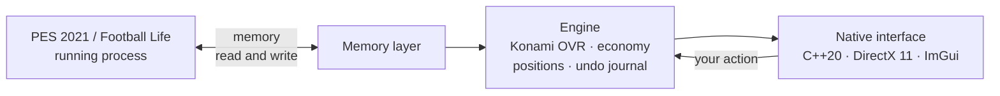

<div align="center">


# PES 2021 - Lettuce Live Editor

**Real-time career editor for eFootball PES 2021**


-0095D9?style=for-the-badge)


<br>


<sub>Screenshots use sample data.</sub>

**English** · [Português](README.pt-BR.md) · [Support](#support-the-project)

</div>

---

### Overview

Native Windows desktop application that reads and edits the career of **eFootball PES 2021 (`v1.7.2.0`)** and compatible derivatives while the game is running. It covers players, squad, finances, scouts, live match and training, in offline modes (Master League, Become a Legend and local matches).

The focus is editing consistently and reversibly. The principles below guide the project.

<table>
<tr>
<td width="20%" valign="top"><b>1. Coherence</b></td>
<td>Editing one number never leaves the rest of the player inconsistent. OVR is recomputed with Konami's formula, attributes move in proportion to the player's profile (the <i>DNA</i>), and market value, salary and release clause follow age, position and country.</td>
</tr>
<tr>
<td valign="top"><b>2. Reversibility</b></td>
<td>Every change can be undone, at four scales: per player (<code>Ctrl+Z</code>), per batch, on the scout lists, and through a global timeline. Before value-changing batches the app writes a JSON squad backup.</td>
</tr>
<tr>
<td valign="top"><b>3. Transparency</b></td>
<td>Nothing happens behind your back. Every action shows what changed, from what to what, and is logged in the history with its time.</td>
</tr>
<tr>
<td valign="top"><b>4. Respect for the game</b></td>
<td>The native cap of 10 skills per player is kept, the primary position stays put while you tune secondary ones, and scout lists only write the native pointer, never touching contract or release clause.</td>
</tr>
<tr>
<td valign="top"><b>5. Lightness</b></td>
<td>About 2.6 MB, one <code>.exe</code>, no Cheat Engine and no runtimes. The loop is event driven: with the window idle, CPU and GPU use is practically zero.</td>
</tr>
</table>

### In 30 seconds

1. Use the executable in `dist/PES 2021 Workbench Native.exe` (or [build it](#build-and-tests)).
2. Start **PES 2021** or **Football Life** and enter **Master League** or **Become a Legend**.
3. Open Lettuce Live Editor, as Administrator if the game is elevated.
4. Highlight a player in the Game Plan. The app captures them in the background and opens everything around them.

### How it works



The interface never writes straight to the game. Every action goes through the engine, which validates it, works out the consequences (attributes, economy, positions), records the previous state in the journal and only then writes to memory. This is why undo is reliable and a whole batch can be reverted at once.

---

### Screens

<table>
<tr>
<td width="50%" valign="top">

<h4>Attributes and DNA solver</h4>
Ask for <code>+1 OVR</code>, <code>-1 OVR</code> or a <b>target OVR</b> between 40 and 99. The solver redistributes points in proportion to the player's profile, then recalibrates market value, salary and release clause. The player levels up while keeping the original profile.
</td>
<td width="50%" valign="top">

<h4>Position Lab</h4>
A tactical map of all 13 positions. Raise or lower a secondary one by 1 without touching the primary, match it to the primary, or set the <code>A / B / C</code> grade. The OVR shown already includes the grade bonus.
</td>
</tr>
<tr>
<td width="50%" valign="top">

<h4>My Squad, in batches</h4>
Filter by expiring contract, injury or U23, tick whoever you want and apply at once: recalibrate economy, <code>+1 OVR (DNA)</code>, stamina, heal, contract and arrow. Ten <b>skill presets</b> by on-pitch role (poacher, dribbling winger, deep-lying playmaker, centre-back, goalkeeper and more) never exceed the cap of 10.
</td>
<td width="50%" valign="top">

<h4>Scouts and Shortlist</h4>
The 4 native lists (3 scout lists and the shortlist) as cards with average OVR, average age and value. Filter, move, copy and remove in batches, undo up to 12 steps, and export or import everything as JSON, matching by ID and by name to carry a list to another save.
</td>
</tr>
<tr>
<td width="50%" valign="top">

<h4>Live Match</h4>
The app detects the match by itself and shows minute and period. Set the exact time, freeze the clock and pick one of 6 selective stamina modes, from "Home 100%" to "Away 100% / Home 5%".
</td>
<td width="50%" valign="top">

<h4>Search across 30,000+ players</h4>
The whole game database, not just your squad. Find any player, open their editor, or tag them straight into the scout lists.
</td>
</tr>
</table>

<div align="center">

<br><sub><b>Command palette</b> (<code>Ctrl+K</code>): any action a few keystrokes away.</sub>
</div>

---

### Technical details

| Question | Answer |
| --- | --- |
| **How does OVR change without unbalancing the player?** | The app uses Konami's exact formula as the cost function and a solver that preserves the ratio between attributes. 30,000 calculations take a few milliseconds. |
| **What about money?** | Market value, salary and release clause come from a calibrated economy model (2025/26 curve) driven by OVR, age, position, country and versatility. It is deterministic and reversible: going back to the old OVR brings back the old value. |
| **What is the blinking arrow?** | A flag independent of the 5 form arrows (bit 7 of byte `0x146` in the player record). The app describes its effect based on Konami's official manual and animates it in the tables. |
| **Can edits be undone?** | Yes. Each player keeps 10 undo states, the global timeline keeps up to 300 actions, batches have "Undo Batch", and there is a JSON backup before heavy operations. |
| **Does it work with patches?** | Yes. It is compatible with Sider 7.3+ and with derivatives such as Football Life, SmokePatch, VirtuaRED and Dream Patch. If an older Workbench is open at the same time, the app warns about the conflict. |
| **Can I share edits between saves?** | **Pack Studio** (JSON v13) exports players and squads and imports them on another save, matching by ID, name or manual pick, with a diff preview and batch rollback. |
| **And training?** | The **Training & BAL** view has the user club's Sub-XP multiplier and the BAL Focus Points unlock. |

### Shortcuts worth learning

| Shortcut | Action |
| --- | --- |
| `Ctrl+K` | Command palette |
| `Ctrl+Z` | Undo the player's last edit |
| `Alt+Left` | Navigate back |
| `Alt+1` to `Alt+8` | Jump straight to each view |
| `Ctrl+1` to `Ctrl+5` | Switch the player subtabs |

### Limitations

- **Offline first.** The app is meant for Master League, Become a Legend and local matches. Do not use it in online modes.
- **It edits the memory of a running process**, with validation, undo and backups. Still, **back up your save** before long sessions.
- **Windows only**, for `v1.7.2.0` of PES 2021 and compatible derivatives.
- **Follows the game's rules.** What the game does not accept, the app does not force. For example, it never goes past 10 skills per player.

### Visual identity

The name and the lettuce logo are the same in every theme. Only the palette changes: **`Blue`** (navy with the Lettuce green accent, the default) and **`Lettuce`** (forest green). Switching is live, in `Settings`, and persisted. Also in `Settings`: always on top, UI scale from 90% to 150%, 6 accent colours, and remembered window size and position. Own vector icons, multi-monitor support with mixed DPI, 7 fonts, `PT-BR / EN` and `EUR / BRL / USD / GBP` round it out.

---

## Build and tests

Requires `clang++` (LLVM-MinGW UCRT x86_64) and Python 3 (generates `native/src/data/game_data.hpp`).

```powershell
powershell -ExecutionPolicy Bypass -File nativeuild.ps1
```

Output: `dist/PES 2021 Workbench Native.exe`.

Engine unit tests (OVR solver, Position Lab, money parser, accent folding, team roles, skill presets and economy model):

```powershell
cd native
clang++ -std=c++20 -O2 -DUNICODE -D_UNICODE -Isrc -Ithird_party/json tests/test_engine.cpp src/engine/ovr_engine.cpp src/engine/pes_engine.cpp src/engine/hooks.cpp src/engine/win32_mem.cpp -lole32 -lshell32 -luser32 -o tests/test_engine.exe
.	ests	est_engine.exe
```

The logo and icon are generated by `native/assets/make_logo.ps1` (GDI+). The images in this README live in `docs/assets`.

## Support the project

This editor is free and open source, and it always will be. If it saves you time and you feel like buying me a coffee, I would really appreciate it. A bug report or a thank you means just as much.

[](https://ko-fi.com/AlfaceJao)

Brazilian? There is a Pix QR code in the [Portuguese README](README.pt-BR.md#apoie-o-projeto).

## License

[MIT](LICENSE)
