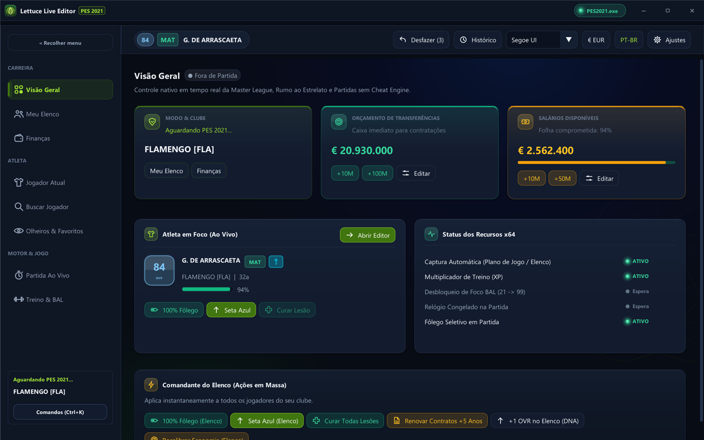
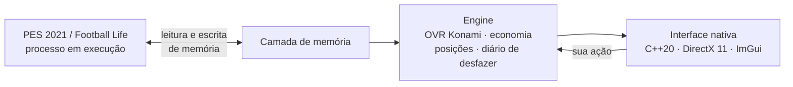
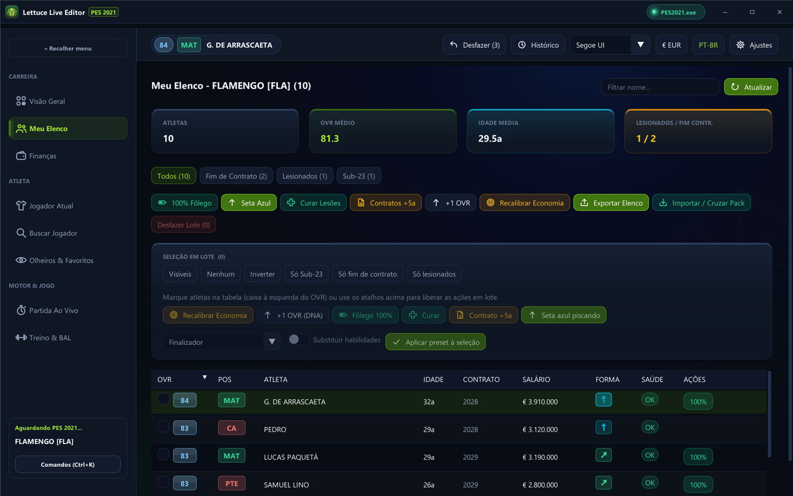
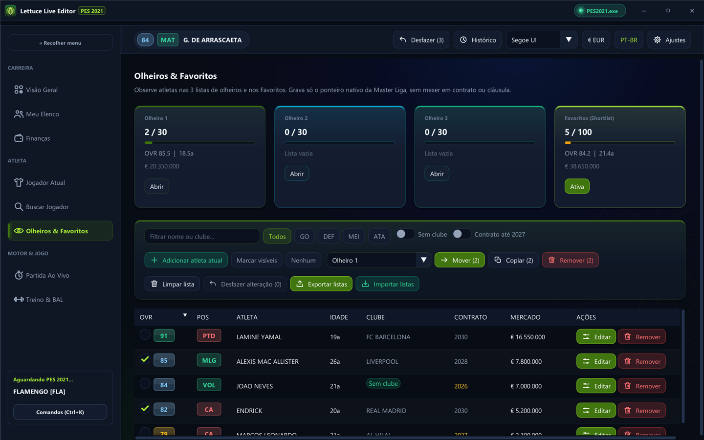
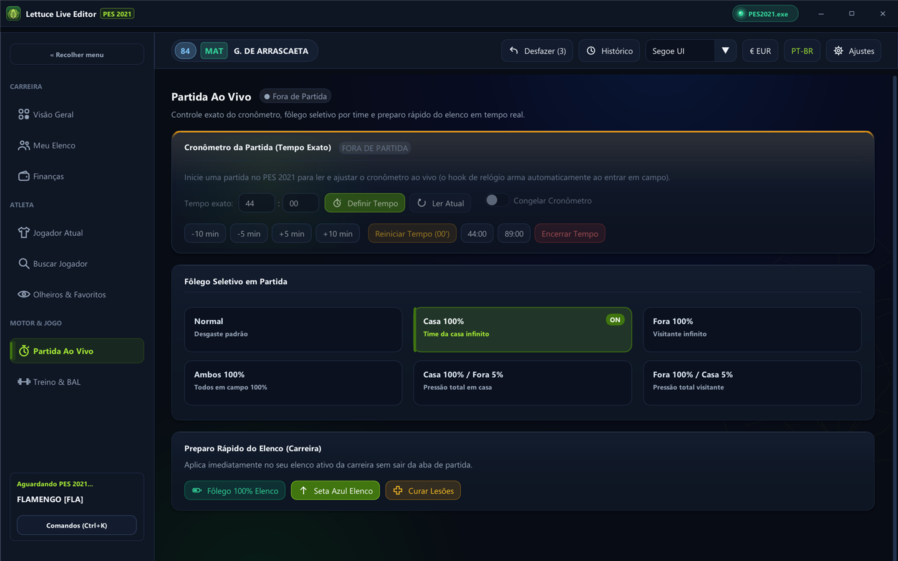
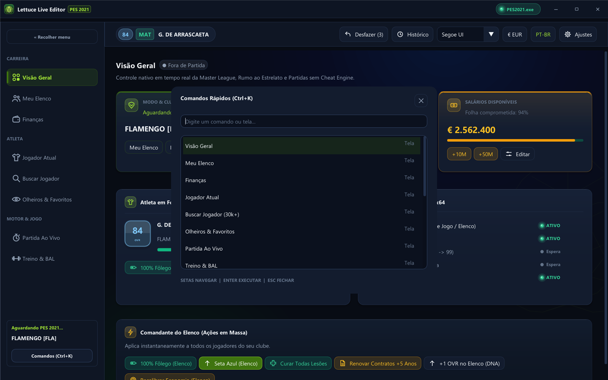

<div align="center">


# PES 2021 - Lettuce Live Editor

**Editor de carreira em tempo real para o eFootball PES 2021**


-0095D9?style=for-the-badge)


[](https://ko-fi.com/AlfaceJao) [](#apoie-o-projeto)

<br>



<sub>Capturas com dados de exemplo.</sub>

[English](README.md) · **Português** · [Apoie](#apoie-o-projeto)

### [Baixar a última versão](https://github.com/Joao-Spala/PES-2021-Lettuce-Live-Editor/releases/latest)

</div>

---

### Visão geral

Aplicativo desktop nativo para Windows que lê e edita a carreira do **eFootball PES 2021 (`v1.7.2.0`)** e de derivados compatíveis enquanto o jogo está aberto. Cobre atletas, elenco, finanças, olheiros, partida ao vivo e treino, em modos offline (Master Liga, Rumo ao Estrelato e partidas locais).

O foco é editar com consistência e com volta. Os princípios abaixo orientam o projeto.

<table>
<tr>
<td width="20%" valign="top"><b>1. Coerência</b></td>
<td>Editar um número nunca deixa o resto do atleta inconsistente. O OVR é recalculado pela fórmula da Konami, os atributos mudam na proporção do perfil do jogador (o <i>DNA</i>), e mercado, salário e multa acompanham idade, posição e país.</td>
</tr>
<tr>
<td valign="top"><b>2. Reversibilidade</b></td>
<td>Toda alteração tem volta, em quatro escalas: por atleta (<code>Ctrl+Z</code>), em lote, nas listas de olheiros e por uma linha do tempo global. Antes de lotes que mexem em valores, o app grava um backup JSON do elenco.</td>
</tr>
<tr>
<td valign="top"><b>3. Transparência</b></td>
<td>Nada acontece escondido. Cada ação mostra o que mudou, de quanto para quanto, e fica registrada no histórico com a hora.</td>
</tr>
<tr>
<td valign="top"><b>4. Respeito ao jogo</b></td>
<td>O limite nativo de 10 habilidades por atleta é mantido, a posição principal não se mexe quando você ajusta as secundárias e as listas de olheiros só gravam o ponteiro nativo, sem tocar em contrato ou cláusula.</td>
</tr>
<tr>
<td valign="top"><b>5. Leveza</b></td>
<td>Cerca de 2,6 MB, um único <code>.exe</code>, sem Cheat Engine e sem runtimes. O laço é guiado por eventos: com a janela parada, o consumo de CPU e GPU é praticamente zero.</td>
</tr>
</table>

### Em 30 segundos

1. [Baixe a última versão](https://github.com/Joao-Spala/PES-2021-Lettuce-Live-Editor/releases/latest), extraia o zip e execute `Lettuce Live Editor.exe` (ou [compile](#build-e-testes)).
2. Abra o **PES 2021** ou o **Football Life** e entre na **Master Liga** ou no **Rumo ao Estrelato**.
3. Abra o Lettuce Live Editor, como Administrador se o jogo estiver elevado.
4. Destaque um atleta no Plano de Jogo. O app o captura em segundo plano e abre tudo sobre ele.

### Como funciona



A interface nunca escreve direto no jogo. Toda ação passa pela engine, que valida, calcula as consequências (atributos, economia, posições), registra o estado anterior no diário e só então grava na memória. Por isso o desfazer é confiável e um lote inteiro pode ser revertido de uma vez.

---

### Telas

<table>
<tr>
<td width="50%" valign="top">

<h4>Atributos e solver de DNA</h4>
Peça <code>+1 OVR</code>, <code>-1 OVR</code> ou um <b>OVR alvo</b> entre 40 e 99. O solver redistribui os pontos na proporção do perfil do atleta e, depois, recalibra mercado, salário e multa. O jogador sobe de nível mantendo o perfil original.
</td>
<td width="50%" valign="top">

<h4>Lab de Posições</h4>
Um mapa tático com as 13 posições. Suba ou desça uma secundária de 1 em 1 sem encostar na principal, iguale à principal ou defina o grau <code>A / B / C</code>. O OVR mostrado já inclui o bônus do grau.
</td>
</tr>
<tr>
<td width="50%" valign="top">

<h4>Meu Elenco, em lote</h4>
Filtre por fim de contrato, lesão ou Sub-23, marque quem quiser e aplique de uma vez: recalibrar economia, <code>+1 OVR (DNA)</code>, fôlego, cura, contrato e seta. Dez <b>presets de habilidades</b> por função em campo (finalizador, ponta driblador, regista, zagueiro, goleiro e outros) sem estourar o limite de 10.
</td>
<td width="50%" valign="top">

<h4>Olheiros e Favoritos</h4>
As 4 listas nativas (3 de olheiros e a de favoritos) como cartões com OVR médio, idade média e valor. Filtre, mova, copie e remova em lote, desfaça até 12 passos e exporte ou importe tudo em JSON, cruzando por ID e por nome para levar a lista a outro save.
</td>
</tr>
<tr>
<td width="50%" valign="top">

<h4>Partida Ao Vivo</h4>
O app detecta a partida sozinho e mostra minuto e período. Defina o tempo exato, congele o cronômetro e escolha entre 6 modos de fôlego seletivo, de "Casa 100%" a "Fora 100% / Casa 5%".
</td>
<td width="50%" valign="top">

<h4>Busca em mais de 30 mil atletas</h4>
A base inteira do jogo, não só o seu elenco. Encontre qualquer jogador, abra o editor dele ou marque direto nas listas de olheiros.
</td>
</tr>
</table>

<div align="center">

<br><sub><b>Paleta de comandos</b> (<code>Ctrl+K</code>): qualquer ação a poucas teclas de distância.</sub>
</div>

---

### Detalhes técnicos

| Pergunta | Resposta |
| --- | --- |
| **Como o OVR muda sem desequilibrar o atleta?** | O app usa a fórmula exata da Konami como função de custo e um solver que preserva a proporção entre os atributos. 30.000 cálculos levam poucos milissegundos. |
| **E o dinheiro?** | Mercado, salário e multa vêm de um modelo econômico calibrado (curva 2025/26) que depende de OVR, idade, posição, país e versatilidade. É determinístico e reversível: voltar ao OVR antigo volta ao valor antigo. |
| **O que é a seta piscando?** | Uma flag independente das 5 setas de forma (bit 7 do byte `0x146` do registro do atleta). O app descreve o efeito com base no manual oficial da Konami e a anima nas tabelas. |
| **Dá para desfazer?** | Sim. Cada atleta guarda 10 estados de desfazer, a linha do tempo global guarda até 300 ações, lotes têm "Desfazer Lote" e há backup JSON antes das operações pesadas. |
| **Funciona com patches?** | Sim. É compatível com o Sider 7.3+ e com derivados como Football Life, SmokePatch, VirtuaRED e Dream Patch. Se uma versão antiga do Workbench estiver aberta ao mesmo tempo, o app avisa do conflito. |
| **Compartilho edições entre saves?** | O **Pack Studio** (JSON v13) exporta atletas e elencos e importa em outro save, cruzando por ID, nome ou escolha manual, com prévia das diferenças e rollback do lote. |
| **E o treino?** | A tela **Treino & BAL** tem o multiplicador de Sub-XP do seu clube e o desbloqueio dos Pontos de Foco do Rumo ao Estrelato. |

### Atalhos que valem a pena

| Atalho | Ação |
| --- | --- |
| `Ctrl+K` | Paleta de comandos |
| `Ctrl+Z` | Desfazer a última edição do atleta |
| `Alt+Left` | Voltar na navegação |
| `Alt+1` a `Alt+8` | Ir direto para cada tela |
| `Ctrl+1` a `Ctrl+5` | Alternar as sub-abas do atleta |

### Limitações

- **Foco em offline.** O app foi pensado para Master Liga, Rumo ao Estrelato e partidas locais. Não o use em modos online.
- **Edita a memória de um processo em execução**, com validação, desfazer e backup. Mesmo assim, **faça backup do seu save** antes de sessões longas.
- **Só Windows**, para as versões `v1.7.2.0` do PES 2021 e derivados compatíveis.
- **Respeita as regras do jogo.** O que o jogo não aceita, o app não força. Por exemplo, ele nunca passa de 10 habilidades por atleta.

### Identidade visual

O nome e o logo de alface são os mesmos em qualquer tema. O que muda é a paleta: **`Azul`** (azul-marinho com destaque verde Alface, o padrão) e **`Alface`** (verde-floresta). A troca é ao vivo, em `Ajustes`, e fica salva. Ainda em `Ajustes`: sempre no topo, escala da interface de 90% a 150%, 6 cores de destaque, e tamanho e posição da janela lembrados. Completam o conjunto ícones vetoriais próprios, suporte a múltiplos monitores com DPI diferente, 7 fontes, idioma `PT-BR / EN` e moeda `EUR / BRL / USD / GBP`.

---

## Build e testes

Requer `clang++` (LLVM-MinGW UCRT x86_64) e Python 3 (gera `native/src/data/game_data.hpp`).

```powershell
powershell -ExecutionPolicy Bypass -File native\build.ps1
```

Saída: `dist/PES 2021 Workbench Native.exe`.

Testes unitários da engine (OVR solver, Lab de Posições, parser monetário, acentos, funções de time, presets de habilidades e modelo econômico):

```powershell
cd native
clang++ -std=c++20 -O2 -DUNICODE -D_UNICODE -Isrc -Ithird_party/json tests/test_engine.cpp src/engine/ovr_engine.cpp src/engine/pes_engine.cpp src/engine/hooks.cpp src/engine/win32_mem.cpp -lole32 -lshell32 -luser32 -o tests/test_engine.exe
.\tests\test_engine.exe
```

O logo e o ícone são gerados por `native/assets/make_logo.ps1` (GDI+). As imagens deste README ficam em `docs/assets`.

## Apoie o projeto

<table>
<tr>
<td width="160" align="center"></td>
<td>

Este editor é gratuito e de código aberto, e vai continuar assim. Se ele economizou seu tempo e você quiser me pagar um café, vou ficar muito agradecido. Um relato de bug ou um obrigado vale tanto quanto.

**Pix:** escaneie o QR ou use a chave aleatória `925fd607-2011-4ca2-83a4-b3cf145b408b`<br>
**De fora do Brasil:** [](https://ko-fi.com/AlfaceJao)

</td>
</tr>
</table>

## Licença

[MIT](LICENSE)
